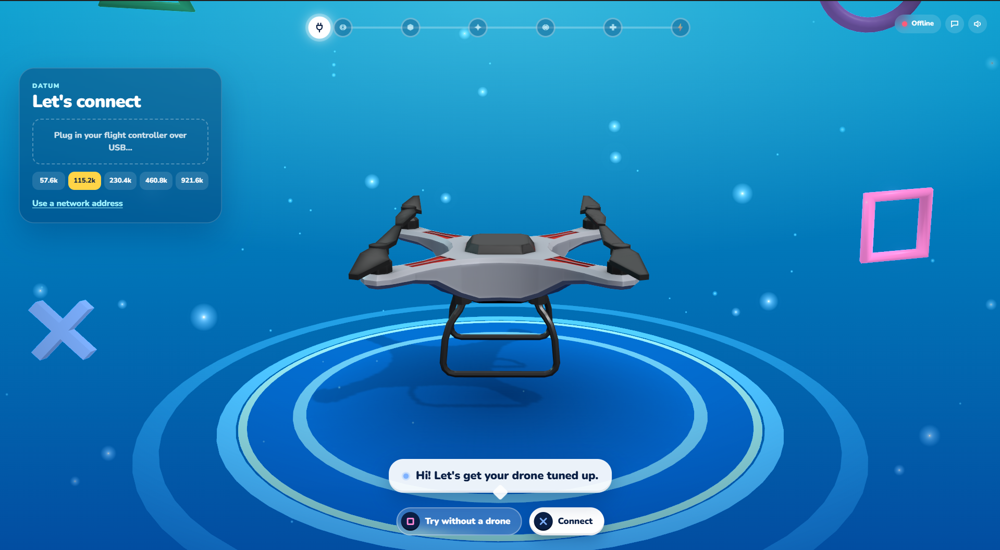
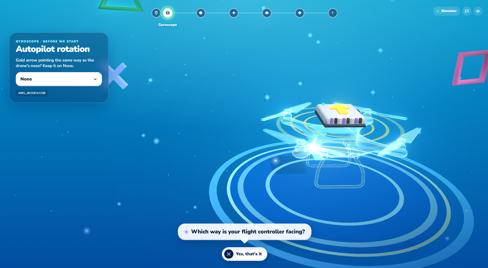
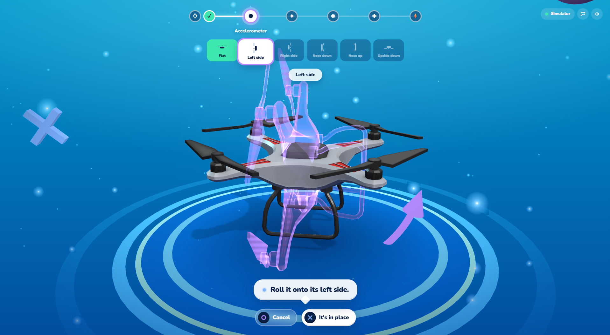
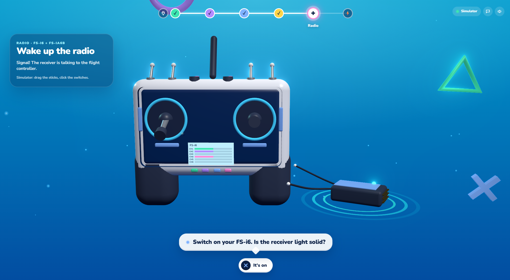
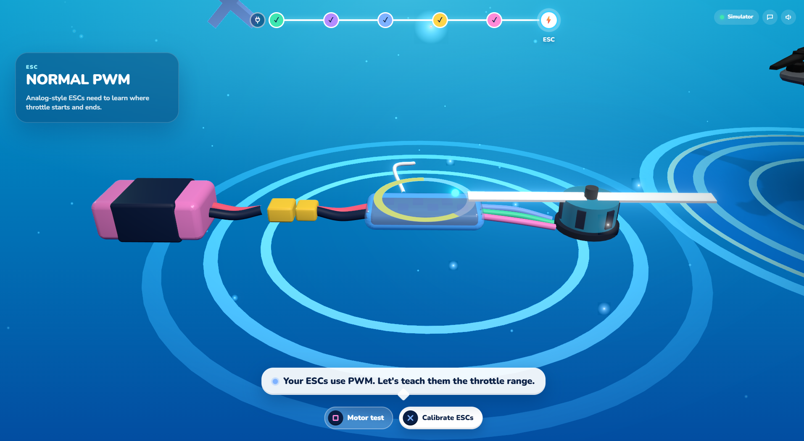

# Datum

An interactive drone calibrator for ArduPilot and PX4 flight controllers, inspired by _Astro's Playroom_.

Datum turns the dry, form-driven sensor calibration screens of a ground-control station into a guided 3D experience. A toy-like drone floats on a stage, mirrors what the real vehicle is doing in real time, and walks you through every step: gyroscope, accelerometer, compass, level horizon, radio and ESCs. It talks MAVLink to the flight controller directly over USB serial, UDP or TCP.



## Features

- **Seven guided steps:** Connect → Gyroscope → Accelerometer → Compass → Level Horizon → Radio → ESC, with a progress track at the top of the screen.
- **Live 3D vehicle:** the drone model follows the flight controller's `ATTITUDE` stream, so you see the vehicle move as you handle it.
- **Ghost-pose hints:** a translucent "ghost" drone and an animated arrow show the next accelerometer pose.
- **Compass coverage sphere:** a geodesic sphere fills in as the field direction sweeps across the body frame, with a hint arrow toward the largest unpainted patch.
- **3D FlySky FS-i6 transmitter:** the sticks and switches mirror the live `RC_CHANNELS` input; unused channels are skipped, not rejected.
- **ESC throttle-range workflow and motor test:** a step-by-step checklist, then per-motor spin tests limited to 1–15 % throttle for at most 5 s.
- **Simulator mode:** every flow runs with no hardware. Drag the screen to tilt the drone, or use a phone as a motion controller.
- **Controller-style input:** ✕ / ○ / □ prompts, synthesized sound effects and optional spoken captions.

## Screenshots

|                                                                                                                                      |                                                                                                        |
| ------------------------------------------------------------------------------------------------------------------------------------ | ------------------------------------------------------------------------------------------------------ |
|  **Autopilot rotation:** confirm board orientation (`AHRS_ORIENTATION`) before calibrating |  **Gyroscope:** calibrated while the vehicle is still           |
|  **Accelerometer:** six-pose sequence with a ghost pose                                    |  **Level horizon:** live roll/pitch bubble level           |
|  **Compass setup:** internal vs. external, `COMPASS_ORIENT`                                  |  **Compass dance:** coverage sphere and rotation hints |
|  **Compass result:** fitness gauge and reboot reminder                                    |  **Radio:** live FS-i6 transmitter and FS-iA6B receiver                      |
|  **Radio result:** per-channel ranges                                                         |  **ESC:** protocol detected from `MOT_PWM_TYPE`                                  |
|  **ESC checklist:** unplug the battery                                                       |  **ESC checklist:** throttle up                                |
|  **Motor test:** spin motors A–D one at a time                                                 |                                                                                                        |

## Architecture

```
┌─────────────── Tauri desktop app ────────────────┐
│  React 19 + react-three-fiber (src/)             │
│   steps/  scene/  hud/  lib/{sim,coverage,...}   │
│        │ invoke()            ▲ events            │
│        ▼                     │                   │
│  Rust backend (src-tauri/src/)                   │
│   calibration.rs — 49 Tauri commands, sessions,  │
│                    vehicle worker thread         │
│   server.rs      — axum WebSocket :8000/ws/gyro  │
└────────┬─────────────────────────────────────────┘
         │ MAVLink v2 (serial / UDP / TCP)
         ▼
   ArduPilot / PX4 flight controller
```

The frontend talks to a single `Backend` interface. `TauriBackend` forwards calls to the Rust commands; `SimBackend` (`src/lib/sim.ts`) is a pretend ArduPilot quad that implements the same interface for hardware-free use.

## Getting started

Prerequisites: [Node.js](https://nodejs.org/) + [pnpm](https://pnpm.io/), [Rust](https://rustup.rs/), and the [Tauri prerequisites](https://tauri.app/start/prerequisites/) for your OS.

Recommended editor setup: [VS Code](https://code.visualstudio.com/) + [Tauri](https://marketplace.visualstudio.com/items?itemName=tauri-apps.tauri-vscode) + [rust-analyzer](https://marketplace.visualstudio.com/items?itemName=rust-lang.rust-analyzer)

```bash
pnpm install
pnpm tauri dev          # desktop app
pnpm dev                # browser-only (simulator)
cd src-tauri && cargo test --lib   # backend tests
```

### Try it without a drone

Open the app in a plain browser (`pnpm dev`), or press **Try without a drone** in the desktop app. A simulated ArduPilot quad runs every flow: drag the screen to tilt the drone (hold Shift to roll), drag the sticks on the 3D transmitter, and click its switches. In the desktop app, a phone that opens `/sender` can stand in for the drone.

Keys: **Enter/Space** = ✕, **Esc** = ○, **S** = □.

### QGroundControl

Datum talks MAVLink to the flight controller itself (USB serial, UDP or TCP), so QGroundControl doesn't need to be running. QGroundControl has no HTTP/WebSocket API, and its "MAVLink forwarding" only sends telemetry _out_: messages arriving on the forwarding link are never relayed to the vehicle, so it can't carry calibration commands. Only one app can own a USB port, so close QGroundControl's connection before connecting Datum.

The guided flows mirror QGroundControl's: the Autopilot Rotation prompt before each sensor calibration, internal/external compass plus compass rotation, the six-pose accelerometer order requested by the autopilot, and the radio stick sequence.
